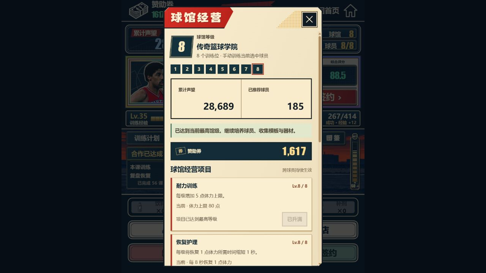

# 游戏全流程审查报告

审查日期为 2026 年 11 月 12 日，针对基础体力 20、balanceVersion=3 的当前版本。

本地在线训练馆的主要经营循环已实现，可以训练、培养、推荐、投资、扩馆和多人在线自动训练；从零到最高馆级已有正式引擎的合法回放单例。**整份设计尚未全部实现**：离线投篮、双排行榜、四种预留消耗品、新作云档与部分账号设置入口仍未开放，生产模板上报也未完成本次线上接收验收。

## 一 审查证据的不同口径

| 证据 | 已覆盖内容 | 不能据此声称 |
| --- | --- | --- |
| 实际浏览器新开局 | 20 体力、手动投篮、课程、模板、推荐、购买、耐力提升、补招冷却、背包和保存续玩 | 真人已从零完整经营到馆级 8，或任意种子有同样结果 |
| 浏览器成熟档 | 导入合法回放来源的 G7 临界档，仅整体平移时间戳，再在生产构建页面升级和操作 | 这段浏览器操作本身经历了全部前期经营 |
| 六组预置培养测试 | 每组 100 种子、升级与模板、真实目录器材的效率；94 件单器材和 25 种子并行 | 已计算这些项目、器材与馆级从零取得的成本和耗时 |
| 从零经营策略测试 | 五策略各 10 种子，共 50 条一小时合法推荐、购买和升馆轨迹 | 无人挂机产出、最优路线或所有长时策略均衡 |
| 从零最高馆级追踪 | staged、种子 1，在 8,405.6 秒模拟时间达到 G8 | 真人约两小时通关，所有种子或全部模板均已验证 |
| 真实终局档的专项动作检查 | 使用已挣取的券补齐五项目、94 件器材和八位，验证第九人拒绝和八人同批自动 | 真人在浏览器逐点买完 94 件，或已收齐 119 个球星模板 |

模拟方法与数据见 [数值测试报告](经验成长与多球员训练测试报告.md)。测试中脚本即时执行管理动作，不计真实点击、判断和菜单耗时；预置与回放导入均单独标明。

## 二 当前功能交付范围

| 模块 | 当前状态与代码依据 |
| --- | --- |
| 首页与本地继续经营 | 已接新经营入口、重开确认、图鉴、球馆档案及设置；重开保留永久图鉴。见 [首页](../src/components/GymHome.tsx)。 |
| 手动经验成长 | 单球 1 秒冷却、消耗本人 1 体力，30／60／10 对应 8／12／20 XP，递增需求、升级每级原 10 点抽样。见 [经验规则](../src/game/gym/progression.ts)、[引擎](../src/game/gym/engine.ts)。 |
| 基础体力与恢复 | 基础 20，项目和器材提高容量，恢复进度、课程返还、满体力截断与饮料已接入。最高容量 80。 |
| 四计划与十球课程 | 基础、投射、突破、内线计划已实现；换计划清未完本课，馆级限制课后追加恢复，倾向与当前效果可查看。见 [训练面板](../src/components/GymPanels.tsx)。 |
| 可选赞助合作 | 每名球员独立三选一、从接取后计球数和课数，同时核验模板及专项条件，推荐时结算。见 [合作规则](../src/game/gym/cooperation.ts)。 |
| 推荐与经营奖励 | 展示基础券、培养加奖、合作和声望明细；培养取最高累计档，当前总上限 27，非每名球员均可得。签约保存校友并释放一位。 |
| 馆级与 1–8 训练位 | 八级门槛和成果核验已编码；升级增加空位，免费补招，每人独立体力、计划、合作、XP、冷却和自动。 |
| 在线自动 | Lv.2 免费解锁，基础 2 秒／球，项目最低 1 秒；仅训练馆页面挂载且浏览器可见时调度，回首页、后台及关闭后不补投篮。见 [页面调度](../src/components/GymGame.tsx)、[存档状态层](../src/gymStore.ts)。 |
| 五可购项目 | 耐力、恢复、招生、器械、自动已接等级帽、费用、购买和实际效果；离线课表另外标为未开放。见 [目录](../src/game/gym/catalog.ts)。 |
| 94 件永久器材 | 目录、固定货架、馆级／收藏条件、购买、仓库、启停、详情和分类已接；全部单件效果及真实终局合法取得已验证。未宣称每张美术均逐件人工检查。 |
| 消耗品 | 仅运动饮料可购买与使用，1 券恢复 10 体力，作用于所选球员。其余四格保留图标但禁用。 |
| 119 模板与双图鉴 | 原成长、身高、核心属性、覆盖、专项分支和外观保留规则继续使用；主屏已接模板目标诊断，已得球星和器材进入独立收藏。119 项存在不等于全部取得均已实测。 |
| 本地存档 | 主备校验、写入失败不发奖、跨页写锁、刷新继续和旧档迁移已接。旧 XP 按适用版本保留比例，旧在训体力按新容量截断，校友历史快照保留。 |
| 本地反馈与设置 | 投篮、升级、课程、合作、模板和推荐有反馈；音效与减少动画已接。仍复用原场景、卡片、竖条和底部按钮风格。 |

## 三 尚未实现或尚未验收的部分

| 项目 | 准确状态 |
| --- | --- |
| 离线投篮及 Timeflow | 离线项目 available=false，当前离开只按本地时间恢复体力。没有离线投篮、回馆结算报告或平台结算验收；安装了技能包不等于已接通。 |
| 球员榜与球馆榜 | 首页入口显示后续开放。旧排行榜源码存在，不代表新经营双榜已实现。 |
| 另外四种消耗品 | 应急护具、回溯秒表、镁粉、训练补剂均为禁用预留格，商店未销售，新效果未交付；旧伤病、回溯、改概率效果不进入当前玩法。 |
| 生产模板解锁上报 | 新作独立持久队列和发送客户端已安装。开发／本地主机禁发，正式发送依赖 HTTPS 服务地址、活动环境与相应统计后端，本次未证明生产接收成功。见 [客户端条件](../src/platform/gymTemplateUnlocks.ts)。 |
| 远程头像资料 | 119 个公开映射中仅 32 个有远程查询 ID，保留 SDK 查询、缓存与本地肖像回退。不能声称 119 人均已通过线上资料验收。见 [适配代码](../src/platform/hupuPlayers.ts)。 |
| 新经营云档、账号刷新与反馈入口 | 当前 GymHome 设置只有音效、减少动画及说明，未接新作云档、账号刷新和意见反馈入口。旧组件保留不计为新入口交付。 |
| 全模板与多种子终局 | 有馆级 8 单例和 94 件器材全取得动作检查，但没有 119 模板全收集证明，也没有多个种子的完整终局耗时／成本分布。 |

本次只审阅公开源码、公开映射与测试产物，不以未检查的秘密配置推断生产服务不存在；这里区分客户端代码、实际接通和本次验收范围。

## 四 本轮实际流程与修复

### 正常浏览器开局

浏览器真实新开 20 体力球员，完成 30 次投篮、三节课程，成长到 Lv.8 并取得轮换／替补模板。接取的基础合作完成后，推荐结算为 2 券、40 声望。随后购买基础投篮机 1 券、耐力项目一级 1 券，补招新人显示满 25 体力及首球 1 秒冷却；背包启停器材、保存返回首页和继续经营的状态保持已检查。

这是一个具体开局观察，不是 30 球都到 Lv.8 或固定获得 2 券、40 声望的保证。基础投篮机购买和启用是两步，耐力只增加当前容量，不立即把原球员补满。

### 成熟档与合法终局检查

合法回放来源的 G7 临界档仅整体平移时钟以适配浏览器当前时间，进入生产构建页面后按实际成果条件免费升至 G8，并成功购买耐力与恢复八级，免费补招至 8/8。两名新人的独立自动开关启用后观察到各自 XP 增长，185 人校友档案可打开。

球星／器材双图鉴可以切换，期间在线训练令球星收录从 82 增至 86，浏览器此档器材为 16/94，不能当成全收齐。运动饮料以 1 券购入，余额 1,618→1,617，使用后库存 1→0 并恢复体力；保存返回首页显示 G8／1,617，继续经营状态一致。排行榜显示后续开放，离线项目保持禁用。

这些是成熟界面的实际操作，不能冒充浏览器从零经营全部过程。补招时一次连续自动化点击曾因 DOM 更新失败，刷新界面元素后逐次招募成功，没有确认由此产生产品错误。

截图显示 G8、8/8、185 名已推荐球员、余额 1,617 与八级项目，来自本轮成熟档验证；消费前后与其他面板的结果按上述操作记录分别说明。

从零合法可达性的证据来自 [终局追踪](balance/economy-endgame-v3.json)：种子 1、staged，在 8,405.6 秒到 G8，声望 28,689、传奇推荐 15、模板收藏 82、累计推荐 185。达到即停时尚有六人和未满项目。

随后 [终局补完检查](balance/endgame-completion-v3.json) 使用该档已赚取的 1,742 券，再花 515 券买满五项目、取得并收藏 94／94 器材、补满八人；第九人招募被拒绝。暂停自动并自然恢复 640 秒后再开八人，单次自动调度产生八球。没有补钱、额外推荐发奖或人为设满体力。

### 已修复的流程问题

- 补招新人至少等待 1 秒，不能以零时间训练与推荐循环绕过冷却。
- 达 Lv.99 后关闭该球员自动，停止继续出手。
- 课程与自动提示自动退场，避免长期遮住球员信息。
- 模板目标补充等级、身高、核心、覆盖、综合与单项下限、稳定／保留等拒绝原因，不再只显示部分差距。
- 自动时间推进保留操作错误，不立即用成功 tick 吞掉失败提示。
- 无到期出手时最多约一秒保存一次，实际到期自动仍按 200 毫秒调度；长期存档性能仍不能由此直接宣布全面通过。

最新领域回归 975 项、渲染回归 78 项通过，共 1,053 项通过，另有 1 个原有跳过；TypeScript 和生产构建通过。测试数量包括既有回归，不能替代未实现功能的交付证明。

## 五 当前仍值得调整或继续验证的问题

### 20 体力使首次等待很早出现

无投资手动连投到第 29 球在 28 秒耗尽体力，课程恰为 9/10，第 30 球到 40 秒才能完成。零加成 Lv.10 平均 191.82 秒，预置初级配置为 44.20 秒，约 4.34 倍。初级配置已经花券、持有器材且以更高容量满体力开始，不能包装为新玩家不等即可获得的体验。

这是选择 20 体力后的实际取舍。可以先观察现有恢复提示、推荐预览是否足够清楚，再决定后续调整；本报告没有用新教学、赠礼或额外玩法掩盖等待。

### 免费补招仍有周转优势

新球员免费满体力，推荐能绕开保留原球员等恢复的时间。当前固定 30 球一小时兑现 261.6 券、声望 5,340.2，但馆级仍为 2；Lv.18 路线为 274.6 券、声望 4,142.3、平均馆级 3.9。中等培养的券优势仅约 5%，主要价值还在高档培养成果与较少管理次数，不能继续引用旧 30 体力时“多 40.9%”。

现有五策略主要在 Lv.2 后使用自动，没有覆盖手动 5／10／29 球、刚出模板就推荐、按培养奖金达标即推荐等所有停止策略，因此没有证明短练最优或早推问题已消失。

### 过早深练与高频管理都有代价

全员早早追 Lv.30 的一小时已兑现只有 5.1 券，另有在训可推荐 17.8 券、311.1 声望。收益留在球员身上，恢复投资容易等不到资金；玩家可以提前推荐改变策略，所以它是周转风险，不是永久死档。mixed 为 195.7 券、staged 为 183.3 券，不支持混合一定更优。

反过来，固定短练模拟平均每小时推荐 131.4 人。实际还需选人、确认、补招、合作与管理，八位自动可能把投篮点击转成频繁查看名册。模拟即时操作不反映真人注意力成本，也不是离开不操作的收益。

### 终局可达不等于终局经济成熟

单例已经合法满足 G8 的 18,000 声望、15 名传奇和 25 种模板要求，并在专项存档动作检查中进一步完成全部可购项目和器材，但末期消费需求偏弱：五项目 458 券、全部器材 436 券，永久投入总共 894 券；该例已兑现 2,121 券，全部买齐仍余 1,227 券。该全购分支与浏览器持有 16/94、1,617 券的演示分支分开记录。

这说明当前终局里赞助券的边际用途可能快速减弱。它不证明所有玩家都有相同冗余，也不构成为消耗券临时增加新模块的依据；应先补更多种子、不同目标与真实管理时长的观察。

### 收藏与平台仍有清晰边界

模板要求同时包含等级、身高、属性与匹配资格，不是到 Lv.18 就给传奇。静态测试按 Lv.30 窗口记录，未获得者右截断；终局单例收录 82／119，仍未证明全图鉴完成。不同计划、偏好、合作和器材组合的平衡也没有穷举。

因此当前适合称为“本地在线经营主要流程已可玩并经过分层验证”。离线投篮、生产后端与双榜等未交付部分继续单列，不能笼统称“所有玩法全部完成”。
