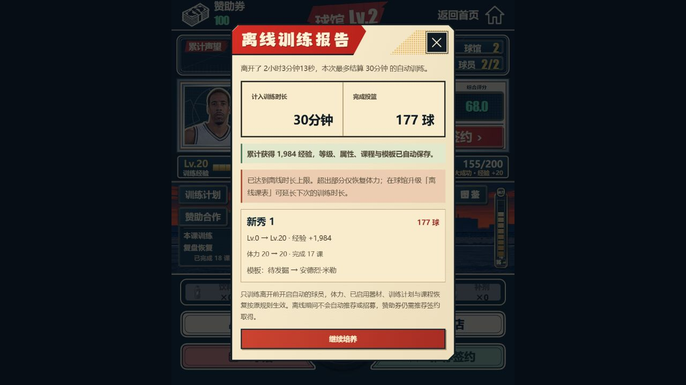
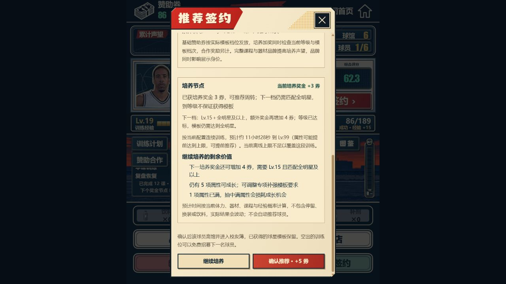

# 离线训练实现与验收

日期：2026-11-13，V5更新。当前交付为本地单机离线训练，与球馆二级的在线自动训练共同免费开放。本轮已落地培养奖金、自动额外XP、缩短离线档位、训练预估和器材仓库流程；器材具体效果与价格待用户自行重设计。配对试算见 [培养收益与自动效率调整报告](培养收益与自动效率调整报告.md)。

> 器材目录版本2已去重为44件，删去50个完全同效条目。本文V4／V5页面截图、测试计数与配装实验保留去重前的原条件，不证明44件目录的完整经济平衡；当前清单见 [器材汇总](器材汇总与定价调整.md)。

旧档解码先将器材映射并去重，随后补算未结清的离开区间；此区间使用精简后的器材配置。已经入账的经验与历史奖励保持，不按旧多件同效叠装继续结算未来训练。

## 规则与项目

仅离开时开启自动的球员投篮，手动球员只恢复体力。回首页、切后台、关闭、刷新及设备休眠后恢复均走同一结算入口；离线不自动推荐、补招、喝饮料、换计划或发放赞助券。球员身价、模板和合作完成状态会随真实训练变化，券与声望依然需要玩家推荐签约才兑现。

| 离线课表等级 | 单次有效训练上限 | 本级价格／券 | 最低馆级 |
| --- | --- | --- | --- |
| 0 | 30分钟（免费） | 0 | 2 |
| 1 | 45分钟 | 2 | 2 |
| 2 | 60分钟 | 4 | 3 |
| 3 | 90分钟 | 7 | 4 |
| 4 | 120分钟 | 12 | 5 |
| 5 | 180分钟 | 21 | 6 |

离线项目累计46券，原五项目458券，六项目升满504券；当前44件器材目录474券，永久全购标价合计978券。标价不包含解锁、培养、饮料或仓库出售／重购，也不代表从零所需时间。

离线沿用自动项目2／1.8／1.6／1.4／1.2／1秒出手间隔，且每级每球额外+1XP，零级仍8／12／20XP，五级为13／17／25XP。体力容量、自然恢复、馆内生效器材、四种训练计划、十球课程、30%／60%／10%随机结果、升级属性与原模板规则均生效。体力不足先等待真实恢复，不能提前借用未来体力或下一课恢复；99级停止并关闭该球员自动。

例如二级馆项目零级、离开两小时，只在前30分钟补投，后90分钟仅恢复体力。超出的训练时间丢弃，结算游标仍推进到回馆时刻，不能重复刷新再领剩余90分钟。买高一级时长前先按旧配置结算，不能用新上限或新器材追算过去。

## 回馆反馈和旧档

结算在共享写锁内读取最新存档、回放、写入主档后才公布结果。摘要列出总球数、实际到账经验、各球员等级与体力变化、课程数及最终模板；没有“领取”按钮。少于5秒或没有实际出手时不弹报告，状态仍正常结算。离线不逐球播放数千次动画。

新版新档带 `offlineRulesVersion:2`。旧档完全缺少标记时只恢复体力并建立基线；已有V1离线档按原30／60／120／240／480／720分钟上限与原基础XP结清已有离开区间，然后升V2。不会用新自动加成追算过去，也不会用缩短后的上限吞掉原区间。旧项目等级、球员、券、图鉴及校友保留；之后离开使用新上限。器材购价记录缺失时按保守历史价迁移，可能不能精确还原实际支出；后续新购按实付记录半价退款。

训练面板、名册和推荐页显示按当前配置连续训练到目标等级的预估，另列下一培养奖金的真实等级与模板缺口。预计球数使用三结果整数XP的停止期望递推，时间按现有体力、冷却、恢复与课程相位推算；随机结果、玩家暂停、换配置及模板匹配会造成实际差异，时间预估不保证获得模板。六维已满时提示继续主要增加等级和展示身价，不强制自动推荐。

时间回拨不倒扣也不重复成长。主档写入失败则不公布报告，保留原状态和游标，重试可完整重算；重复回馆、双标签同时回来串行提交，同段训练只消费一次。重复离开回调也不会移动已经建立的离开时刻。

## 实现与验证

[离线引擎](../src/game/gym/offline.ts)跳到下一次真实出手或体力恢复时刻，调用与在线相同的训练函数；同刻按球员ID排序并消费存档中的随机流，不按平均成功率估算。记录过程中实际解锁的模板，不只记录最终模板。上限内分段与一次回放的球员、体力、课程、收藏和随机状态应一致。

长回放只复制一次历史存档；同一批次每名球员首球与升级时执行完整匹配，等级和属性未变时复用已经确定的匹配结果，在线路径保持原调用。已覆盖八人离开12小时但仅训练新上限3小时；测试机执行时间不代表所有设备性能。

新增与调整的测试覆盖：

- 一级锁定、二级免费与所有时长档位；手动球员不投。
- 与原在线逐次动作完整状态等价、同刻顺序、切换选中不改变随机分配。
- 体力零点／恢复边界、课程返还、实际经验结余、99级与其他球员继续。
- 30分钟封顶、超时仅恢复、刷新去重、回拨和上限内分段一致性。
- 双页签同时回馆、失败写入后重试、旧档首次基线、重复离开、设备休眠和购买上限前先结算。
- 页面后台回归、只训练开启自动者、报告关闭与不重复弹出、项目页二级解锁和升级。

V4历史回归为994领域＋81渲染，合计1075项通过；V5验证另补在本节后方，不能以V4计数代替新规则验收。

以下为V4生产页面独立合成测试档的历史证据：100测试券、两名Lv.0、仅一人自动，离开2小时3分13秒后仅结算30分钟，177球／1984XP／Lv20；另一人不投，券未自动增加。V4的4券升级到1小时现已改为2券升级到45分钟，截图不作为V5升级价格证明。

11月12日的旧数值报告保留为历史条件，不能将其旧器材价格或“离线未开放”用于当前结论。新价五策略各10种子、共50条连续管理一小时回放见 [原始数据](balance/economy-equipment-v4.json)：全部到二级馆，但Lv.18路线毛券169.5低于短练272.2约37.7%。该回放没有离线收益，不证明新奖励提案或整体经济已平衡。

## 平台边界

本轮参考本地 `shaper-timeflow` 技能的回放、幂等和身份边界，但没有接通Timeflow平台。技能要求正式平台通过BFF验证身份与球馆归属、由服务端决定区间，并提供定义激活和六组平台验证证据；当前仅前端本地存档，不能声称这些平台验收完成，也没有将平台服务凭据放入浏览器。

后续需要可信服务端结算时再按技能协议接入；本地成长、报告和项目当前即可使用。

## V5最终验收

领域回归1014项通过，渲染回归89项通过，合计1103项通过，另有1项原有跳过；生产构建与TypeScript通过。最后调整后的预测、存档及库存专项24项再次通过。六配置与94单器材预置脚本全部通过新版存档结构检查。

生产页面使用独立六级馆合成档：100初始测试券，经正式动作买入四件馆内器材后86券，自动三级、离线课表二级，离开约10分44秒。回馆补投117球、1675XP至Lv18，未自动发券。推荐面板显示首发基础2＋已满足Lv10首发奖金3＝5券，同时说明下档仍缺全明星、已获3券可先兑现，不把等级门槛当成模板保证。

满位购买训练营补贴先弹替换确认；取消未扣券，确认换下基础投篮机后86→84券，旧件进入仓库。再从仓库装回投篮机并替换矫正训练仪，仓库出售矫正训练仪返1券后84→85，仓库清空而器材图鉴仍5/94。随后离线二级升三级60→90分钟扣7券，自动三级升四级额外XP3→4扣18券，最终余额60。保存首页、重载继续均保留状态；离开1分47秒后按90分钟上限正常补投17球／248XP。

替换预览的实际效果损失已修复并在生产页复验：纯品牌器材替换投篮机，会明确显示恢复16→17秒／点（变慢）；取消后余额仍60。该流程没有声称从零自然经营到六级。

[仓库半价出售截图](evidence/v5-equipment-sale.jpg) · [替换损失预览截图](evidence/v5-replacement-preview.jpg)。本轮不重做器材具体效果与价格，保持用户后续设计的范围。
